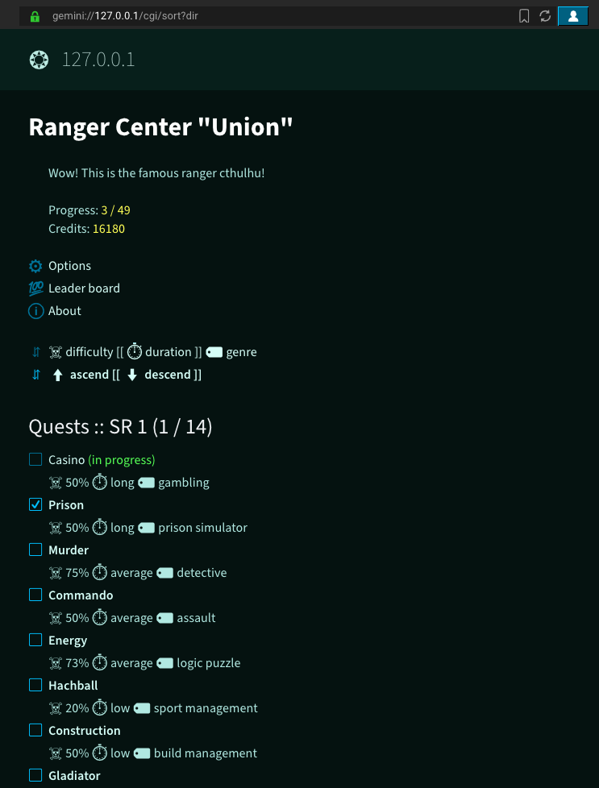
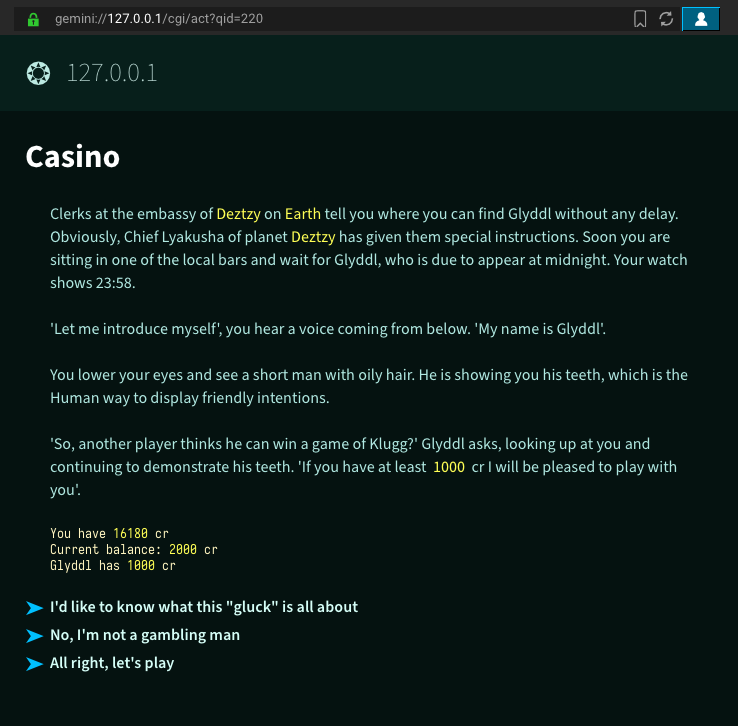

# Gemini capsule with "Space Rangers" text-quests

Online-player of text quests from the ["Space Rangers"][4] game in [Gemini Protocol][2].

The capsule is designed as an extension for the [GmCapsule][1] gemini server.

The quest-player itself is ported from the [space-rangers-quest][0] repo. Many thanks to @roginvs!

|   |   |
|---|---|
|||

Some quests are translated into several languages: CZE, DE, EN, ES, FR, HU, PL, RU.
So the capsule is multilingual.

## Launch

Preparations
```
# clone repo
$ git clone https://codeberg.org/cthulhu/gm-space-rangers-quests.git
$ cd gm-space-rangers-quests

# prepare virtual environment
$ python3 -m venv .venv
$ source .venv/bin/activate
(.venv) $ pip install -r requirements.txt

# generate 127.0.0.1 cert
(.venv) $ ./gen-selfsigned-cert.sh
```

Launch:
```
(.venv) $ PYTHONPATH=$PYTHONPATH:./ gmcapsuled -c config-local.ini
```

Open [gemini://127.0.0.1/](gemini://127.0.0.1/) in gemini-browser ([Lagrange][3] recommended).

## Development

* `/borrowed/qm/` -- dir for quests from "Space Ranges"
* `/gmsrq/` -- gemini capsule
* `/srqmplayer/` -- python port of the quest player
* `/content/` -- static content, quest images/sounds/tracks
* `99_gm_mod_srquests.py` -- [GmCapsule][1] server extension

Create migration:
```shell
$ pw_migrate create --auto \
  --database "sqlite:/./users/gmsrq.sqlite" \
  --directory ./gmsrq/migrations \
  <migration_name>
```
Migrate:
```shell
$ pw_migrate migrate \
  --database "sqlite:/./users/gmsrq.sqlite" \ 
  --directory ./gmsrq/migrations
```
Rollback:
```shell
$ pw_migrate rollback \
  --database "sqlite:/users/gmsrq.sqlite" \
  --directory ./gmsrq/migrations/ \
  --count 1
```

Localization:
```shell
$ pybabel extract --project=gmsrq --version=0.1 -o locale/gmsrq.pot \
  srqmplayer/*.py gmsrq/*.py
$ pybabel init -D gmsrq -i locale/gmsrq.pot -d locale -l ru
$ pybabel update -D gmsrq -i locale/gmsrq.pot -d locale
$ pybabel compile -D gmsrq -d locale
```

[0]: https://github.com/roginvs/space-rangers-quest
[1]: https://codeberg.org/skyjake/gmcapsule
[2]: https://geminiprotocol.net/
[3]: https://codeberg.org/skyjake/lagrange
[4]: https://www.gog.com/en/game/space_rangers_hd_a_war_apart
